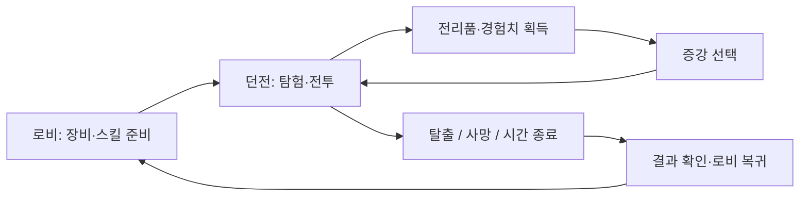

# Deep & Deeper

> 동료와 던전을 탐험하고, 전리품을 챙겨 살아 돌아오는 1~4인 협력 RPG

**Deep & Deeper**는 레테(LETHE) 팀이 Unreal Engine 5.7로 제작한 1인칭 협력 PvE 던전 탐험 게임입니다. 무기와 스킬을 준비해 던전에 진입하고, 전투와 파밍으로 얻은 보상을 탈출을 통해 가져옵니다. 더 깊이 탐험할지, 지금 가진 것을 지키며 귀환할지 판단하는 긴장감과 동료 간 협력이 핵심입니다.

---

## 목차

- [시연 영상](#시연-영상)
- [실행 파일](#실행-파일)
- [개발 환경에서 실행](#개발-환경에서-실행)
- [문서](#문서)
- [프로젝트 개요](#프로젝트-개요)
- [게임 컨셉](#게임-컨셉)
- [게임 진행 흐름](#게임-진행-흐름)
- [게임 규칙](#게임-규칙)
- [조작 방법](#조작-방법)
- [주요 구현 시스템](#주요-구현-시스템)
- [소스 구조](#소스-구조)
- [팀 구성](#팀-구성)
- [협업](#협업)
- [기술 스택](#기술-스택)
- [향후 개선 방향](#향후-개선-방향)

---

## 시연 영상

[](https://drive.google.com/file/d/1yzB-v8w2hYPFXn6QTCNiOOQo1WDlBMoD/view)

**[실제 플레이 영상 보기 · 3분 40초](https://drive.google.com/file/d/1yzB-v8w2hYPFXn6QTCNiOOQo1WDlBMoD/view)**

로비 준비 → 협력 전투 → 전리품 획득 → 레벨업·증강 선택 → 보스전 순서로 실제 플레이를 담았습니다. 썸네일을 누르면 Google Drive 재생 화면이 열립니다.

영상 BGM: *Clash Defiant* — Kevin MacLeod ([incompetech.com](https://incompetech.com/)), [CC BY 4.0](https://creativecommons.org/licenses/by/4.0/). 영상 길이에 맞게 편집했습니다.

## 실행 파일

**[Windows 실행 파일 다운로드](https://drive.google.com/drive/folders/1ETb0UZjFaOOf8t3SdxGxvEH7iK0ZXASP)**

1. 배포 폴더에서 패키징 파일을 다운로드하고 압축을 해제합니다.
2. 실행 파일과 함께 제공된 콘텐츠·엔진 폴더를 같은 위치에 유지합니다.
3. Steam 클라이언트에 로그인한 상태에서 패키지의 실행 파일을 실행합니다.
4. 로비에서 세션을 만들거나 참가한 뒤, 장비와 스킬을 준비하고 출격합니다.

멀티플레이 참가자는 같은 버전의 패키지를 사용해야 합니다.

## 개발 환경에서 실행

필요한 환경은 **Unreal Engine 5.7**, 해당 엔진의 C++ 빌드를 지원하는 Visual Studio 툴체인과 Windows SDK, **Git LFS**입니다. Steam 세션 테스트에는 실행 중인 Steam 클라이언트가 필요합니다.

```powershell
git lfs install
git clone --branch main https://github.com/NBcampUnrealTrack/8th-Team5-Final-Project.git
cd 8th-Team5-Final-Project
git lfs pull
```

1. `HeavenBreach.uproject`에서 프로젝트 파일을 생성하고 `HeavenBreachEditor / Win64 / Development`로 빌드합니다.
2. 에디터에서 `/Game/Levels/Lobby/L_Lobby`를 열어 Play로 실행합니다.
3. 로비의 출격 흐름으로 던전에 진입합니다. 게임 맵은 로비 GameMode의 `GameplayMap` 설정을 따릅니다.

프로젝트 루트에서의 빌드 예시입니다. 엔진 설치 위치가 다르면 첫 번째 경로를 변경합니다.

```powershell
$projectPath = (Resolve-Path '.\HeavenBreach.uproject').Path
& 'C:\Program Files\UE_5.7\Engine\Build\BatchFiles\Build.bat' HeavenBreachEditor Win64 Development "-Project=$projectPath" -WaitMutex -NoHotReloadFromIDE
```

GAS, StateTree, CommonUI, PCG, Steam OSS·SteamSockets, Geometry Scripting을 사용하며 DLSS 관련 플러그인은 `Plugins/NVIDIA/`에 있습니다. C++나 플러그인 변경 후 DLL 잠금 문제가 발생하면 에디터와 디버깅 세션을 종료한 뒤 다시 빌드합니다.

현재 개발용 Steam App ID는 `480`입니다. PIE의 로컬 다중 플레이 확인과 별도 PC·Steam 계정을 이용한 실제 세션 테스트는 구분해서 진행합니다.

---

## 문서

| 문서 | 내용 |
|---|---|
| [CONTRIBUTING.md](CONTRIBUTING.md) | 브랜치 · 커밋 · PR · 언리얼 전용 협업 규칙 |
| [PR 템플릿](.github/pull_request_template.md) | PR 작성 양식 |

---

## 프로젝트 개요

| 항목 | 내용 |
|---|---|
| 프로젝트명 | Deep & Deeper |
| 장르 | 1인칭 협력 PvE 탐험 · 탈출 익스트랙션 RPG |
| 인원 | 1~4인 |
| 엔진 | Unreal Engine 5.7 |
| 개발 언어 | C++ / Blueprint |
| 플랫폼 | PC (Windows) — Steam 세션, 리슨 서버 |
| 핵심 키워드 | GAS, StateTree AI, PCG 던전, 스킬 · 패시브 빌드, 증강, 장비 각인, 창고 · 로컬 저장 |

---

## 게임 컨셉

어두운 석조 통로와 폐허, 몬스터와 함정이 있는 판타지 던전을 무대로 합니다. 1인칭 시점에서 주변을 살피며 전투하고, 장비와 소모품을 관리하면서 다음 방으로 나아갑니다. 던전 탐험·탈출 장르의 위험과 보상 구조를 바탕으로, 동료와 역할을 나누고 상황에 맞게 빌드를 구성하는 경험을 목표로 했습니다.

### 코어 판타지

- 제한된 자원으로 미지의 공간을 탐색하고, 발견한 전리품을 직접 챙겨 귀환하는 탐험가
- 무기와 스킬, 증강을 조합해 자신에게 맞는 전투 방식을 만드는 플레이어
- 서로의 위치와 공격 타이밍을 맞춰 위기를 넘기는 동료

### 핵심 메커니즘

- **스킬 빌드** — 직업은 없다. 로비에서 액티브 2개(Q · E)와 패시브 1개를 정하고 들어가며, 고른 스킬과 패시브에 따라 플레이 방식이 달라진다
- **세션 성장** — 던전 안에서 경험치를 얻어 레벨을 올리고, 증강으로 빌드를 키운다. 세션이 끝나면 초기화된다
- **전투** — 연계 평타, 패링 · 방어태세, 경직, 가드 불가 공격. 아군 피해(Friendly Fire)가 적용된다
- **탐험** — PCG 로 조립되는 방 단위 던전. 방마다 적 · 상자 · 함정이 배치된다
- **파밍** — 적 시체 · 상자 루팅, 랜덤 각인이 붙는 장비, 패널티가 따르는 악세서리, 제작 · 상점
- **탈출** — 탈출 지점에서 빠져나가야 들고 있던 것을 가지고 돌아간다

---

## 게임 진행 흐름

```
게임 실행 → 로비
  · 세션 생성 / 참가 (1~4인)
  · 액티브 2개 · 패시브 1개 선택
  · 장비 · 창고 정리, 제작 · 상점
  · 전원 준비
→ 던전 진입 (PCG 로 조립된 던전, 제한시간 시작)
  · 탐험 · 전투 · 함정
  · 몬스터 시체 · 상자 루팅
  · 경험치 획득 → 레벨업 → K 키로 증강 선택
  · (선택) 보스 공략
→ 탈출 지점에서 탈출 / 사망 (시체를 남기고 관전) / 시간 종료
→ 결과 화면 → 로비 (탈출했으면 들고 나온 아이템이 창고로)
```

별도의 타이틀 레벨 없이 게임을 실행하면 바로 로비로 들어갑니다.



---

## 게임 규칙

### 세션

- 호스트가 서버 역할을 하는 **리슨 서버** 방식, 최대 4인
- 서버 시간 기준 제한시간을 공유. C++ 기본값은 **25분(1,500초)**이며 GameMode 블루프린트에서 조정 가능 (`MatchDurationSeconds`)
- 매치는 모든 플레이어가 **탈출했거나 사망**했을 때, 또는 **시간이 끝났을 때** 종료
- 탈출은 플레이어마다 각자 진행
- 보스 공략은 선택

### 세션 성장

- 세션 레벨 1 ~ 10, 몬스터 처치로 경험치 획득
- 레벨업 시 증강 선택 기회 — K 키로 증강 창을 열어 선택
- 증강으로 선택한 스킬 · 패시브를 강화하거나 새 패시브를 얻음
- 레벨 · 경험치 · 증강은 세션이 끝나면 **초기화** (영구 캐릭터 성장 없음)

### 사망 · 탈출

- 사망하면 시체를 남기고 생존한 팀원을 관전
- 시체는 팀원이 루팅할 수 있음
- **탈출에 성공한 플레이어가 들고 있던 아이템만** 창고에 보관
- 사망 후에는 관전 및 결과·로비 복귀 흐름으로 진행
- 제한시간 종료 시 아직 탈출하지 않은 플레이어는 실패 처리되고, 들고 있던 아이템을 잃음
- 살아 있는 상태에서 탐험을 포기하는 경우에도 소지품 상실 처리. 리슨 호스트의 이탈은 다른 참가자의 진행·저장 상태에 따라 제한

### 아군 피해 (Friendly Fire)

- 플레이어의 공격은 팀원에게도 맞는다. 위치 선정과 공격 타이밍이 중요
- 함정은 플레이어 · 적 모두에게 피해와 상태 이상을 준다
- 적끼리는 같은 편 필터(`Team.Enemy`)로 서로 맞지 않는다

### 아이템

- 장비 등급: 일반 · 레어 · 에픽 · 전설
- 장비에는 **랜덤 각인**이 붙는다 (무기 · 방패 · 방어구)
  - 좋은 옵션 개수: 일반 0 / 레어 1~2 / 에픽 1~3 / 전설 3~5
  - 나쁜 옵션: 레어 이상, 좋은 옵션과 따로 굴려 0~1개
  - 한 장비 안에서 같은 스탯 · 같은 타입은 중복되지 않음
- 악세서리는 강력한 효과와 함께 패널티가 따른다
- 장비에는 내구도가 있고, 파손되면 효과가 꺼진다
- 기본 인벤토리는 코드 기준 **6×5**, 창고는 **10×35** 격자. 실제 크기는 컴포넌트 설정과 가방 데이터에 따라 달라질 수 있음
- 아이템마다 `GridWidth / GridHeight` 크기를 가지며 회전 배치·자동 정렬·중첩 분할 지원
- 중첩 한도는 아이템 데이터의 `MaxStack`을 따름. 제작 재료·수량·골드 비용은 레시피 데이터로 관리

---

## 조작 방법

| 입력 | 동작 |
|---|---|
| WASD | 이동 |
| Mouse | 시점 조작 |
| Space | 점프 |
| Left Shift | 달리기 (마나 소모) |
| Left Ctrl | 앉기 |
| Left Click | 무기별 기본 공격. 활은 누르기·놓기로 당김과 발사 |
| Right Click | 관통 사격·트리플 샷 준비 취소 |
| R | 패링 · 방어태세 (누르고 있기) |
| Q / E | 액티브 스킬 1 / 2 |
| 1 ~ 4 | 퀵슬롯 아이템 사용 |
| F | 상호작용 (길게 누르기 — 상자 · 시체 루팅, 문) |
| Tab | 인벤토리 |
| K | 증강 창 |
| Esc | 메뉴·설정, 활성 UI 닫기 |

관통 사격·트리플 샷은 해당 Q/E 스킬을 준비한 뒤 좌클릭을 유지해 당기고, 충분히 당긴 후 놓으면 발사합니다. 테스트 맵의 Z/X/C/V 키와 숫자키 무기 교체는 실제 게임의 Q/E 및 퀵슬롯 입력과 별도입니다.

---

## 주요 구현 시스템

> 구현 설명은 `main`의 소스와 에셋 구성을 기준으로 정리했습니다. 세부 밸런스와 선택 가능한 스킬은 블루프린트·데이터 에셋 설정을 따릅니다.

### Game Flow · 세션

- 로비 → 던전 → 결과로 이어지는 흐름 (`AHeavenBreachGameMode`, `AHBLobbyGameMode`)
- 로비: 전원 준비 → 시작 확인 → Seamless `ServerTravel` 로 던전 진입
- 로비 슬롯에 각 플레이어 캐릭터와 장착 장비를 그대로 표시
- Steam 세션 생성·검색·참가·초대와 이동을 관리 (`UHBOnlineSessionSubsystem`, Steam OSS·SteamSockets), 현재 실행 기준은 리슨 서버
- 호스트의 시작 확인과 준비 상태를 검사한 뒤 이동. 매치 중 탈출·사망·시간 종료에 따라 결과와 복귀를 처리
- 이동 중 로딩 UI를 표시하고 도착 맵의 플레이 준비 상태를 확인. 진행률과 퍼센트 텍스트를 표시 (`UHBLobbyLoadingSubsystem`)

### 플레이어 캐릭터

- 1인칭 카메라를 머리 뼈에 붙이고, 에임 오프셋으로 시점과 조준을 맞춤
- GAS 의 ASC 와 어트리뷰트를 PlayerState 에 두어 레벨 이동 후에도 유지
- 체력 · 마나 · 이동 속도 · 공격 속도 어트리뷰트, 체력 재생
- 모듈형 장비 외형 — 투구 · 상의 · 하의 · 신발 메쉬가 몸 메쉬 포즈를 따라감 (`SetLeaderPoseComponent`)
- 발소리 · 카메라 흔들림 · 포션 마시기 · 상호작용 동작

### 빌드 (스킬 · 패시브 · 증강)

- 직업 없이 액티브 2개 · 패시브 1개를 골라 빌드를 구성
- 로비에서 고른 구성(`FHBStartingLoadout`)이 PlayerState 를 타고 던전까지 전달됨
- 세션 레벨 · 경험치 (`AHB_PlayerState`, 최대 레벨 10)
- 증강 — 레벨업마다 스킬 강화 · 패시브 강화 · 신규 패시브 선택 (`UHB_SkillAugment`)

#### 액티브 스킬

계열은 스킬을 설명하기 위한 구분입니다. 직업을 고정 선택하는 방식이 아니며, 무기 조건이 있는 스킬은 해당 무기를 장착해야 사용할 수 있습니다.

| 계열 | 대표 스킬 | 동작 |
|---|---|---|
| 근접 | 도약 공격 | 전방으로 도약해 공격 |
| 근접 | 전투의 함성 | 자신에게 전투 강화 효과 부여 |
| 근접 | 피의 광란 | 흡혈 효과를 사용하는 자기 강화 |
| 근접 | 회전 베기 | 시전자 주변 범위 공격 |
| 활 | 회피 공격 | 지상에서 뒤로 물러나며 화살 1발 자동 발사 |
| 활 | 사냥꾼의 표식 | 조준 지점 주변 적에게 표식 부여 |
| 활 | 관통 사격 | 준비·당김·해제 후 관통 화살 발사 |
| 활 | 트리플 샷 | 당김 후 세 발을 동시에 부채꼴로 발사 |
| 마법 | 원소 구체 | 시전 후 조준 방향으로 투사체 발사 |
| 마법 | 순간 이동 | 벽·지면 등 목적지 조건을 검사하고 전방 이동 |
| 마법 | 서리 지대 | 지정 지점에 감속 지대 생성 |
| 마법 | 마력 폭발 | 시전 후 시전자 주변 범위 피해 |

활·마법 스킬은 각각 `Combat/Ability/Bow/`, `Combat/Ability/Magic/`, 근접 스킬은 `Combat/Ability/Melee/`와 `Warrior/`에서 확인할 수 있습니다.

#### 패시브

아래는 현재 코드에 구현된 패시브입니다. 수치와 강화 단계는 각 스킬 및 증강 데이터에서 관리합니다.

| 패시브 | 효과 |
|---|---|
| 강철 심장 | 최대 체력 증가 |
| 전투 본능 | 낮은 체력에서 공격력 증가 |
| 피의 갈증 | 적 처치 시 체력 회복 |
| 받아치기 | 평타 중 패링 허용 |
| 견고한 자세 | 홀드 방어 자원 소모 감소 |
| 방어태세 | 패링 창 이후에도 홀드 방어 유지 허용 |
| 사냥꾼의 호흡 | 달리기 마나 소모 감소·마나 회복 강화 |
| 민첩한 발걸음 | 이동속도 증가 |
| 급소 포착 | 헤드샷 피해 증가 |
| 가벼운 착지 | 낙하 피해 감소 |
| 집중 | 마법 시전 시간 감소 |
| 마력 순환 | 액티브 스킬 마나 소모 감소 |
| 잔류 마력 | 액티브 스킬 적중 시 장착 액티브 쿨다운 감소 |
| 유리 대포 | 스킬 피해와 받는 피해가 함께 증가 |

### 전투 (GAS)

- 무기별 기본 공격 — 근접 연계 공격·활 당김과 발사·스태프 공격. 근접 콤보는 몽타주 구간과 입력 창을 사용 (`GA_PlayerAttackRE`, `ANS_ComboWindow`), 활은 `GA_PlayerBowAttack`으로 처리
- 패링 · 방어태세 — 방패를 든 상태에서만, 정면 각도 안의 공격
  - 방어태세: 막은 공격의 피해 무효
  - 패링: 막기에 더해 근접 공격자를 경직시킴
  - (`GA_PlayerParry`, `GA_GuardStance`)
- 플레이어 경직 (`GA_PlayerStagger`)
- 공격 성질 태그 — 공격 어빌리티의 Activation Owned Tags 로 표현
  - `State.Attacking.Unblockable` : 막기 · 패링 불가
  - `State.Attacking.Stagger` : 막지 못하면 경직
- 피해 계산 (`HBDamageCalculation`)
  - `최종 피해 = 원본 피해 × 부위 배율 × 100 / (100 + 방어력) × 방어 배율 × 기타 배율`
  - 헤드샷 2배, 장비의 받는 피해 옵션 등은 기타 배율로 곱해짐
- 타격 연출 — 맞는 쪽이 결과(패링 > 방어 > 무기 성질) 순으로 GameplayCue 를 고름 (`HitCuePlay`, `GameplayCue.Hit.*`)
- 근접 판정 컴포넌트 · 노티파이를 플레이어와 적이 공용으로 사용 (`UMeleeTraceComponent`, `ANS_MeleeHitDetect`)

### 적 AI

- **StateTree** 기반 행동, AI Perception 시야 감지
- 경계 컴포넌트 (`UAlertComponent`) — Idle / Alerted / Engaged / Lost 상태와 타겟 관리
  - 어그로: 먼저 인식한 플레이어 우선
  - 소리가 아니라 시야로만 타겟 확정, 놓치면 마지막 위치 수색
- 메쉬(물리 애셋 바디) 단위 피격 판정 — 캡슐은 이동 전용. 부위별 피해 배율
- 가중치 기반 패턴 선택 (`UEnemyAbilitySystemComponent::TryActivateWeightedAbilityByTag`)
- 피격 반응 두 갈래
  - 일반 피격: 목 · 상체만 움찔하는 additive 몽타주 (공격 · 이동을 끊지 않음)
  - 경직: 패링에 당했을 때만, 공격을 끊는 상체 몽타주
- **경계 팀 (`AlertTeam`)** — 같은 방의 같은 팀 몬스터 하나가 맞거나 플레이어를 처음 발견하면 팀 전원이 그 위치로 수색
- 소환 · 빔 · 잡기 등 특수 공격 어빌리티 (`EnemySummonGABase`, `EnemyBeamGABase`, `UGrabComponent`)
- 드랍 · 시체 루팅 · 경험치 보상

#### 몬스터 구성

현재 던전에서 사용하는 몬스터는 근접·원거리·특수 패턴 역할로 구분합니다. 기존 에셋 경로의 Heaven, Remnant 등은 제작 당시 식별자이며, 아래 표는 세계관의 종족 분류가 아닌 구현 에셋 기준입니다.

| 에셋 폴더 | 전투 역할·패턴 |
|---|---|
| Remnant_Blade | 인간형 근접 공격·콤보, 소환용 변형 |
| Remnant_Archor | 발사체 기반 원거리 공격, 소환용 변형 |
| SteamWolf · Sabertooth | 물기·발톱 공격과 빔 패턴 에셋 |
| HeavenWarden | 좌우 주먹 공격·도약 공격 |
| WarpedDelver | 근접 공격·잡기와 물어뜯기 |
| ParagonSevarog | 근접 공격·돌진·소환 패턴 |

관련 블루프린트와 데이터 에셋은 `Content/Monsters/`에 있습니다. 각 방에 실제 배치되는 종류와 수는 조우 설정에 따릅니다.

### 보스 구역 · 기믹

- 보스 구역 상태를 Waiting → Fighting → Cleared로 관리하고 복제 (`AHBBossArenaController`)
- 보스가 살아 있는 구역에 플레이어가 진입하면 문을 닫고 잠금. 보스 처치 후 문 개방·탈출 지점 표시
- 잠금 시간이 만료되면 문을 다시 열고 대기 상태로 전환. 시간은 레벨에서 조정 가능
- 기믹 상자 트리거와 봉인 문 등 공간 진행 요소를 별도 액터로 구성 (`AHBGimmickChestTrigger`, `ASealedDoorActor`)

### 아이템 · 장비

- 장비 슬롯: 무기 · 보조 장비(방패) · 투구 · 상의 · 하의 · 악세서리 · 가방, 내구도
- 장비 스탯은 하나의 GE 로 합산 적용 (`UGE_EquipmentStats`)
- **랜덤 각인** — 좋은 옵션 · 나쁜 옵션을 등급별 규칙으로 굴려 붙임 (`DT_Engrave`, `ItemEngraving`)
  - 상자 · 몬스터 드랍 · 제작 · 상점 · 초기 지급 등 아이템이 생기는 모든 곳에서 굴림
  - 버리고 주워도, 저장했다 불러와도 각인이 유지됨
- **악세서리 동작 효과** — 오라 · 조건부 · 주기 효과를 데이터로 조합 (`DT_ItemEffect`, `ItemEffectRules`)
- 무기·방패는 전용 데이터 테이블, 방어구·악세서리·소모품·재료·가방 등은 아이템 데이터로 구성
- 포션은 아이템 종류별 쿨타임을 공유하며 서버 시간 기준으로 퀵슬롯·인벤토리에 표시
- 가방의 내부 격자 크기와 내용물, 장비의 각인과 내구도를 인스턴스 데이터로 관리

### 인벤토리 · 창고 · 제작 · 상점

- 2D 그리드를 이용한 격자 인벤토리 · 창고 (`UInventoryComponent`, `UStashComponent`), 퀵슬롯
- 상자 · 적 시체 루팅 (`ABoxActor`, `ULootComponent`)
- 제작 (`UCraftComponent`): 레시피 선택, 창고 재료 자동 채우기, 재료·골드·결과물 공간 검사 후 제작
- 상점 (`UShopComponent`): 구매·판매 요청을 서버에서 처리하고 골드·아이템을 갱신
- 드래그 배치·회전·자동 정렬·중첩 분할과 가방 창을 지원. 컨테이너 간 이동은 서버 RPC로 검증

### 저장

- **각 PC 가 자기 데이터의 주인** — 로컬 `USaveGame` 으로 창고 · 인벤토리 · 장비 · 퀵슬롯 · 로비 구성 저장 (`UHBPlayerSaveComponent`)
- 접속하면 내 PC 가 파일을 읽어 서버로 나눠 보내고(창고는 40줄씩), 서버가 검사한 뒤 적용
- 이전 데디케이티드 기획 당시 작성된 외부 서버(HTTP) 저장 방식으로 전환할 수 있는 구조 (`EHBSaveMode`)

### PCG 던전

- 방 모듈을 커넥터로 이어 붙여 던전을 조립 (`HBDungeonRuntime`, `HBDungeonModuleDefinition`)
- 레벨 디자이너가 놓은 스폰 지점에 방별 조우 규칙으로 적 · 상자 배치 (`HBEncounterSubsystem`, `HBChestSpawnSubsystem`)
- 봉인 문 · 탈출 지점 (`ASealedDoorActor`, `AExtractionZone`)
- 서버가 생성한 방·세대·포탈 정보를 던전 스냅샷으로 공유 (`HBDungeonSnapshot`)
- 클라이언트의 방 표시와 준비 상태를 확인해 게임 시작 및 로딩 종료와 연결

### 함정

- 함정 기본 클래스 (`AHBTrapBase`) — 레벨 디자이너가 BP 자식에 모델을 붙이고, 태그 단 충돌체로 판정
  - 발동 방식: 항상 / N초마다 / 범위에 들어오면 / BP 직접
  - 예고 → 작동 → 재정비 단계를 서버가 정하고 복제, 연출은 BP 이벤트로
  - 발판 반응: 감지(살아 있는 대상만) / 무게(시체도 누름)
  - 함정에 ASC 를 두어, 가드 불가 · 경직 · 타격 큐를 기존 피격 코드 그대로 사용
- 진자 컴포넌트 (`UHBPendulumComponent`) — 서버 시간 기준으로 흔들어 모든 화면과 서버 판정이 같은 박자. 날이 바닥을 지날 때 휘두르는 소리
- 구현된 함정: 가시 함정, 진자 도끼

### UI

- CommonUI의 `Game / GameMenu / Menu / Modal` 레이어와 Activatable Widget Stack으로 화면 관리 (`UHB_UILayout`, `UHB_ActivatableWidget`)
- 활성 화면이 입력 모드와 기본 포커스를 선언하고, 닫히면 아래 화면의 입력 설정으로 복귀
- HUD: 체력·마나, 스킬·퀵슬롯, 세션 정보와 증강 진입
- 로비: 플레이어 준비·장비 외형, 스킬 선택, 창고·제작·상점
- 인벤토리·루팅: 장비·소지품·대상 컨테이너를 연결하고 툴팁·상세 정보·아이템 메뉴 표시
- 결과·관전·로비 복귀, 이동 중 로딩 화면과 진행률 표시
- 설정: 그래픽·DLSS 지원 여부, 음량, 마우스 감도, 전투 카메라 흔들림 및 머리 움직임 반영 세기

### 애니메이션 · 그래픽 · 사운드

- 무기별 상체 애니메이션과 하체 이동을 분리하고 Aim Offset으로 조준 방향 반영
- Blender에서 팔·손목·그립과 무기 배치를 조정한 뒤 Unreal 애니메이션·몽타주로 연결
- 일부 몬스터는 Tripo 메시 → AccuRig 리깅 → Blender 크기 조정 → Mixamo 애니메이션 리타겟팅으로 제작
- Niagara 이미터·모듈·머티리얼을 활용한 무기·스킬 VFX와 GameplayCue 연동
- 마법 VFX는 `UHBMagicVFXPreloadSubsystem`에서 미리 로드하고 참조를 유지해 반복 사용 시 준비 비용을 줄임
- 로비·인게임·로딩 BGM, 발소리·포탈·무기 파괴·UI 효과음을 게임 흐름에 연결

---

## 소스 구조

> 코드 · 모듈명은 프로젝트 초기 이름인 `HeavenBreach` 를 그대로 씁니다 (`Source/HeavenBreach/`, `AHeavenBreachGameMode` 등).

```
Source/HeavenBreach/
├── AI/            적 캐릭터 · AI 컨트롤러 · 경계 컴포넌트 · 적 GAS 어빌리티 · 애님 노티파이
├── Player/        플레이어 캐릭터 · 컨트롤러 · PlayerState · 스킬 구성 · 어트리뷰트
├── Combat/        공격 · 방어 · 경직 · 피해 계산 · 게임플레이 큐 · GE · 함정(Trap)
├── Core/          게임모드 · 게임 흐름 · 로비 · 세션(Online) · 태그 · 저장(DataManagement)
├── Item/          아이템 데이터 · 각인 · 악세서리 동작 효과
├── Equipment/     장비 슬롯 · 장비 스탯
├── Inventory/     인벤토리 · 창고 · 퀵슬롯
├── Loot/          상자
├── Craft/         제작
├── Shop/          상점
├── Interaction/   상호작용 (길게 누르기)
├── Door/ · SealedDoor/ · Escape/   문 · 봉인 문 · 탈출 지점
├── PCGModule/     PCG 던전 조립 · 조우 · 상자 배치
├── Boss/          보스 구역 상태 · 보스 문
├── Gimmick/       기믹 상자 트리거
├── Currency/      재화 관리
├── Level/         레벨 요소
├── UI/            CommonUI · HUD · 로비 · 설정 · 로딩
├── Tests/         자동화 테스트 및 독립 기능 테스트용 코드
├── PCGPrototype/  PCG 프로토타입
└── Variant_*/     초기 템플릿 · 참고 코드
```

자동화 테스트는 `Tests/` 외에도 각 기능 폴더의 `*Tests.cpp`에 함께 배치되어 있습니다.

### 레벨

| 맵 | 용도 |
|---|---|
| `/Game/Levels/Lobby/L_Lobby` | 현재 기본 시작 맵·로비 |
| `/Game/Levels/DeepAndDeeper` | 패키징 대상 던전 맵 |
| `/Game/Levels/ExtractionResult` | 패키징 대상 결과 맵 |
| `/Game/Levels/TierA/Maps/Floor_A` | 기존 TierA 던전 레벨 |
| `/Game/Levels/GameStart/L_Startup` | 별도 시작 연출·로딩 테스트 맵. 현재 기본 시작 맵은 아님 |

기본 맵은 `Config/DefaultEngine.ini`, 패키징 맵 목록은 `Config/DefaultGame.ini`, 실제 로비 출격 목적지는 로비 GameMode 블루프린트의 `GameplayMap`에서 설정합니다.

---

## 팀 구성

**레테 / LETHE · 8명**

| 이름 | 역할 | 주요 담당 |
|---|---|---|
| 권기문 | 팀장 · UI/UX·크리쳐 아트 | 크리쳐 메시·애니메이션, VFX 제작·연동 |
| 문창욱 | 부팀장 · 게임모드·네트워크 | GameMode/GameState, Steam 리슨서버, PCG 맵 생성 |
| 강대근 | 메인 기획·기믹 | 게임 규칙·밸런싱, CommonUI, 기믹·서브시스템 |
| 홍민기 | 적 AI·전투 시스템 | StateTree·GAS 기반 AI, 공용 행동과 공격 패턴 |
| 이재호 | 인벤토리·거래·제작·레벨 디자인 | 그리드 인벤토리, 장비·상점, 구매·판매·제작 |
| 이채호 | 던전 레벨 디자인 | 공간 구성, 스폰·파밍·탈출 동선 |
| 박상진 | 아이템·장비·메시 연동 | 장비 슬롯 UI, 소켓 메시, 데이터 테이블 |
| 김태민 | 메인 아트·애니메이션 | UI 리소스·아키텍처, HUD 연출 |

## 협업

**Git Flow (develop 완충)** — `feat/*` → `develop`(통합) → `main`(발표 · 제출 안정판). 상세 규칙은 [CONTRIBUTING.md](CONTRIBUTING.md).

---

## 기술 스택

| 분류 | 사용 기술 |
|---|---|
| Engine | Unreal Engine 5.7 |
| Language | C++ / Blueprint |
| Gameplay | Gameplay Ability System (GAS) |
| AI | StateTree, AI Perception, NavMesh |
| Level | PCG, Level Instance |
| Networking | 리슨 서버, Replication · RPC (서버 권위), Steam OSS · SteamSockets |
| UI | UMG + CommonUI |
| Animation | Animation Blueprint, Montage, Additive Animation, AnimNotify / NotifyState |
| VFX · Sound | Niagara, GameplayCue |
| Save | USaveGame (로컬), HTTP 백엔드 (선택) |
| Rendering | DLSS |
| VCS | Git (GitHub) + Git LFS |

---

## 향후 개선 방향

- **맵 최적화**: NavMesh Bounds Volume을 필요한 탐색 영역에 맞추고 PCG 생성 후 내비게이션 갱신 비용 점검
- **라이팅·LOD**: 조명과 그림자 비용을 프로파일링하고 메시 LOD·원거리 표시 및 컬링 기준 조정
- **VFX**: 동시 전투에서 이미터·파티클 수, 오버드로와 에셋 준비 비용을 측정하고 품질 단계별 조정
- **멀티플레이 안정성**: 지연·연결 종료·반복 출격·호스트 이탈 상황에서 저장과 세션 복귀 회귀 검증
- **사용성·밸런스**: 스킬·증강 선택, 아이템 정리와 툴팁, 무기별 조준·공격 연출을 실제 플레이 피드백으로 개선

위 항목은 추후 개선 계획이며 전체 최적화나 모든 네트워크 상황의 검증이 완료됐다는 의미는 아닙니다.
